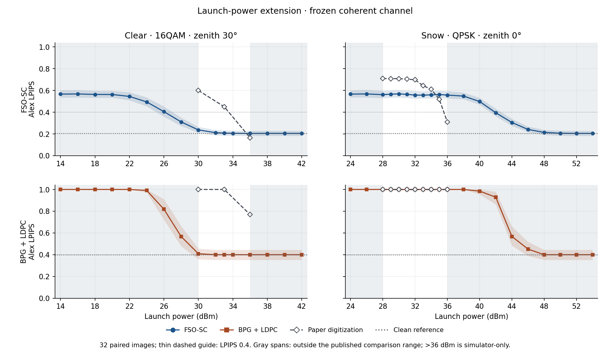

# FSO-SC Colab 재현

[English README](README.md) · [결과와 한계](docs/LATEST_RESULTS.md) · [데이터 및 체크포인트](docs/REPLAY.md)

Wenbin Chen 외의 “Free Space Optical Semantic Communication for Satellite Remote Sensing Image Transmission” (*IEEE Transactions on Communications*, 2025)의 **비공식 독립 부분 재현**이다. [원 논문 DOI](https://doi.org/10.1109/TCOMM.2025.3562356)

공개된 설명을 바탕으로 시맨틱 이미지 압축과 심볼 단위 광링크를 구현했다. 시뮬레이터에서 전력 증가에 따른 점진적 복원과 잡음 학습을 거친 체크포인트의 강건성 개선을 확인했다. **같은 송신전력에서 논문 수치가 일치하거나, 논문의 전력 이득 및 광학 실험을 재현했다는 뜻은 아니다.**

## 핵심 결과

| 실험 | 확인한 것 |
| --- | --- |
| [v27 / v31 — 송신전력](docs/LATEST_RESULTS.md) | 전력 범위를 넓히면 FSO-SC는 점진적으로 회복하고 비교군 BPG+LDPC의 복호는 더 급격하게 전환된다. 맑음은 논문보다 일찍, 눈은 늦게 회복한다. |
| [v32 — Stage 1 vs. Stage 2](docs/LATEST_RESULTS.md) | 같은 채널 실현에서 Stage 2는 오류가 있을 때 품질 저하가 작았지만 무채널 LPIPS는 0.186에서 0.205로 나빠졌다. 잡음 주입만의 단독 효과를 분리한 비교는 아니다. |
| [v33 / v34 — 수신기 진단과 개선](docs/LATEST_RESULTS.md) | 같은 파형과 가중치로 24 dBm의 16QAM BER을 26.50%에서 10.68%로 낮췄다. 선택적 수신기 개선으로, 논문과의 수치 차이를 해결한 결과는 아니다. QPSK는 변경하지 않았다. |



논문 값은 그림에서 읽은 근사값이며 저자가 공개한 원시 측정값이 아니다. 회색은 논문의 비교 범위를 벗어난 시뮬레이터 구간이다. LPIPS는 작을수록 좋다. 전력축 이동·곡선 평활화·잡음 보정은 하지 않았다.

## Colab에서 실행

필요한 노트북을 내려받은 다음 [Google Colab](https://colab.research.google.com/)에서 **파일 → 노트북 업로드**를 선택한다. 학습·영상 평가에는 GPU를 사용한다. 실행 코드가 노트북에 들어 있어 별도로 `.py` 파일을 올릴 필요는 없다.

| 노트북 | 용도 |
| --- | --- |
| [01 — 데이터 검사](notebooks/01_prepare_GEE.ipynb) | 사용자가 준비한 데이터 ZIP 3개 검증. 다운로드·학습 없음. |
| [02 — 자체 데이터로 학습](notebooks/02_train.ipynb) | 이전 2단계 기본 모델을 새로 학습한다. v25 학습 경로와는 다르다. |
| [03 — 자체 모델 평가](notebooks/03_final_holdout.ipynb) | 02에서 학습한 모델을 두 채널 프로필 및 native BPG 비교군과 평가한다. [이전 결과](docs/RESULTS.md)는 별도 보존했다. |
| [v27 — 논문 그림 조건 평가](notebooks/frozen/FSO_SC_paper_figures_full_v27.ipynb) | 고정 v25 가중치로 Fig. 4–8의 소프트웨어 조건을 평가한다. 무채널 포함 146,800개 이미지×방식 평가. |
| [v31 — 송신전력 범위 확장](notebooks/frozen/FSO_SC_power_extension_v31.ipynb) | 고정 v25 및 원본 v27 결과·BPG 비트열로 맑음·눈을 평가한다. |
| [v32 — Stage 1·2 비교](notebooks/frozen/FSO_SC_stage_effect_v32.ipynb) | 고정 Stage 1·2에서 실제 LPIPS와 각 모델의 무채널 대비 악화량을 비교한다. |
| [v33 — 수신기 손실 진단](notebooks/frozen/FSO_SC_receiver_transition_v33.ipynb) | 같은 관측에서 기존 DSP와 진단용 이상적 보상을 비교한다. |
| [v34 — 16QAM 위상 복구 개선](notebooks/frozen/FSO_SC_qam16_phase_repair_v34.ipynb) | 재학습 없이 기존·새 수신기를 비교한다. |

**새 데이터로는 01–03부터 실행한다.** 고정 실험 노트북은 원본 파일의 SHA를 검사하므로 새 모델을 대입할 수 없다. 집계와 그래프를 보는 데에는 Drive 파일이 필요 없으며, 동일 조건 재실행에 필요한 비공개 파일은 [이 목록](docs/REPLAY.md)에서 확인할 수 있다. 데이터 준비는 [데이터 문서](docs/DATA.md)를 참고한다.

## 구현과 검증

- MoVQ/VQGAN 계열의 시맨틱 압축: 256 × 256 RGB, 32 × 32개의 14비트 인덱스, 코드북 16,384개·임베딩 차원 4, 0.21875 bpp.
- Málaga FSO 및 QPSK/8QAM/16QAM. 공개식의 배경광 전용 프로필과 추가 수신 잡음을 포함하는 coherent 프로필을 구분한다. 저자의 미공개 VPI 수신기와 동일하다고 주장하지 않는다.
- 실제 BPG 0.9.8 및 재현 가능한 rate-3/4 LDPC 대체 코드. 평균 원천 비트율을 맞춰도 FEC·패딩을 포함한 총 채널 사용량은 다르다. BPG 실패 표식 1은 실제 LPIPS가 아니다.

세부 사항: [논문 명시값과 구현 가정](docs/ASSUMPTIONS.md) · [고정 모델의 학습 계보](docs/REPLAY.md#how-the-frozen-model-was-produced).

```sh
python tools/check_release.py --manifest
python -m pip install -r requirements.txt
python -m unittest discover -s tests -v
```

패키지 검사는 GPU·가중치·Drive 없이 가능하다. 합성 테스트는 구현 검증이며 논문 수치 재현의 증거는 아니다.

## 인용 및 권리

원 연구는 [Chen 외 (2025)](https://doi.org/10.1109/TCOMM.2025.3562356)를 인용한다. 데이터 ZIP·가중치·비공개 실험 파일·논문 PDF·BPG 바이너리는 공개본에 포함하지 않는다. 저장소 자체 라이선스는 아직 선택하지 않았고, 외부 구성요소는 [별도 권리 안내](THIRD_PARTY_NOTICES.md)를 따른다.
