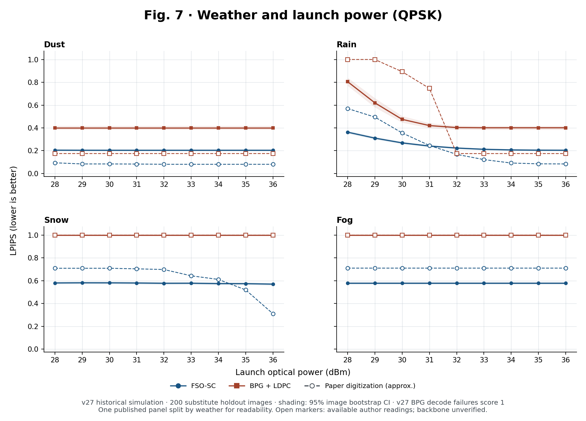

# Reproducing FSO-SC in Colab

[한국어 README](README.ko.md) · [Paper figure gallery](docs/PAPER_FIGURES.md) · [Paper tables](docs/PAPER_TABLES.md) · [Data and checkpoints](docs/REPLAY.md)

An **unofficial, independent partial reproduction** of Wenbin Chen et al., “Free Space Optical Semantic Communication for Satellite Remote Sensing Image Transmission,” *IEEE Transactions on Communications*, 73(10), 9168–9183, 2025. [Paper DOI](https://doi.org/10.1109/TCOMM.2025.3562356)

We implemented the semantic image codec and a symbol-rate optical link from the published description. We recovered the qualitative power response and the benefit of a noise-trained checkpoint in our simulator. **We did not reproduce the paper’s numerical curves at the same launch powers, verify its reported power gain, or replicate the optical hardware experiment.** This repository is not affiliated with the paper's authors.

## Results by paper figure

The v27 software sweep evaluated 732 distinct channel-condition × method cases on 200 images, plus two no-channel references. The gallery distinguishes direct comparisons with readable paper markers from plots of our results alone.

| Paper item | Reproduction coverage |
| --- | --- |
| [Fig. 4 — Zenith angle](docs/PAPER_FIGURES.md#fig-4--zenith-angle) | Three powers, three modulations, and FSO-SC, BPG, and BPG+LDPC. |
| [Fig. 5 — Reconstructed images](docs/PAPER_FIGURES.md#fig-5--reconstructed-images) | Matched link settings on substitute scenes; the notebook regenerates examples with local inputs. |
| [Fig. 6 — Pointing error and background light](docs/PAPER_FIGURES.md#fig-6--pointing-error-and-background-light) | All six panels, including the three background radiances. |
| [Fig. 7 — Weather](docs/PAPER_FIGURES.md#fig-7--weather) | Four weather conditions and nine QPSK power points. |
| [Fig. 8 — Receiver diversity](docs/PAPER_FIGURES.md#fig-8--receiver-diversity) | MRC/EGC, receiver count, and Málaga scattering ratio. |
| [Figs. 1–3 and 9–12](docs/PAPER_FIGURES.md#architecture-and-hardware) | Architecture mapped to code; hardware experiments not replicated. |
| [Tables I–III](docs/PAPER_TABLES.md) | Simulation settings and weather coefficients checked against the implementation; lab-equivalent link budget independently recalculated. |

[](docs/PAPER_FIGURES.md#fig-7--weather)

## Follow-up diagnostics

| Experiment | What we found |
| --- | --- |
| [v27 / v31 — launch-power response](docs/LATEST_RESULTS.md) | FSO-SC recovers gradually when the sweep spans the transition; the tested BPG+LDPC baseline has a sharper decoding transition. Clear air recovers earlier and snow later than in the paper. |
| [v32 — Stage 1 vs. Stage 2](docs/LATEST_RESULTS.md) | On the same received-channel realizations, Stage 2 generally loses less quality under errors but has worse no-channel LPIPS (0.205 vs. 0.186). This is a checkpoint comparison, not an isolation of the effect of noise training. |
| [v33 / v34 — receiver diagnosis and repair](docs/LATEST_RESULTS.md) | The 16QAM phase-tracking variant lowered BER from 26.50% to 10.68% at 24 dBm with the same waveform and weights. It is optional and does not resolve the paper-to-simulator gap. QPSK is unchanged. |

The [v31 power-extension plot](results/figures/v31_power_response.png) shows two selected cases, not the full sweep. Gray regions extend beyond the published comparison range and are simulator-only. See [the detailed v27–v34 results](docs/LATEST_RESULTS.md) and [the earlier baseline](docs/RESULTS.md).

## Run in Colab

Download the notebook you want and upload it through **File → Upload notebook** in [Google Colab](https://colab.research.google.com/). Use a GPU for training or image evaluation. Notebooks contain their execution code and do not require uploading the Python helpers separately.

| Notebook | Inputs and purpose |
| --- | --- |
| [01 — Audit data](notebooks/01_prepare_GEE.ipynb) | Check three user-supplied data ZIPs; no data download or training. |
| [02 — Train on your own data](notebooks/02_train.ipynb) | Train an earlier, standalone two-stage baseline using your ZIPs. This is **not** the v25 training lineage. |
| [03 — Evaluate your model](notebooks/03_final_holdout.ipynb) | Evaluate the matching model from 02, with both channel profiles and native BPG baselines. The published earlier run is documented [separately](docs/RESULTS.md). |
| [v27 — Paper figure grid](notebooks/frozen/FSO_SC_paper_figures_full_v27.ipynb) | Locked v25 checkpoint; a large software sweep for figures 4–8. Budget: 146,800 image/method evaluations including no-channel references. |
| [v31 — Extend launch power](notebooks/frozen/FSO_SC_power_extension_v31.ipynb) | Locked v25 and original v27 metrics/bitstreams; clear 16QAM and snow QPSK. |
| [v32 — Compare training stages](notebooks/frozen/FSO_SC_stage_effect_v32.ipynb) | Locked Stage 1 and v25 Stage 2; compare raw quality and channel-induced degradation. |
| [v33 — Diagnose the receiver](notebooks/frozen/FSO_SC_receiver_transition_v33.ipynb) | Locked v25; current DSP and a true-complex-gain oracle on the same observation. |
| [v34 — Compare 16QAM phase tracking](notebooks/frozen/FSO_SC_qam16_phase_repair_v34.ipynb) | Locked v25; compare the original and new receivers without training. |

**Start with 01–03 for your own data.** The frozen notebooks verify the original inputs by checksum and cannot use a newly trained checkpoint in their place. The published aggregates and figures can be inspected without any Drive files; the exact replay inputs are not bundled. See [the exact file list](docs/REPLAY.md) and [data preparation](docs/DATA.md).

## What is implemented

- A MoVQ/VQGAN-style codec: 256 × 256 RGB, a 32 × 32 grid of 14-bit indices, 16,384 embeddings of dimension 4, and a nominal **0.21875 bpp**.
- QPSK, rectangular 8QAM, and 16QAM over a symbol-rate Málaga FSO link. We separate the public-equation background-only interpretation from the coherent extension with additional receiver noise. Neither is a claim to have recovered the authors' VPI configuration.
- Native BPG 0.9.8 and a reproducible seeded rate-3/4 LDPC substitute. Matching average **source** bitrate does not match total channel use once FEC and padding are included. A BPG failure marker of 1 is not a measured LPIPS value.

See [published parameters and implementation assumptions](docs/ASSUMPTIONS.md) and the [frozen training lineage](docs/REPLAY.md#how-the-frozen-model-was-produced).

## Verify the release

From this directory:

```sh
python tools/check_release.py --manifest
python -m pip install -r requirements.txt
python -m unittest discover -s tests -v
```

The package check needs no weights, GPU, or Drive. The synthetic tests check the implementation, not numerical reproduction. Full BPG evaluation builds the official codec separately in Colab.

## Citation and rights

Please cite [Chen et al. (2025)](https://doi.org/10.1109/TCOMM.2025.3562356) for the original work. Dataset ZIPs, checkpoints, private run files, the paper PDF, and BPG binaries are not distributed here. See [third-party notices](THIRD_PARTY_NOTICES.md). A repository license has not been selected; the example repository's license does not apply here.

```bibtex
@article{chen2025fso_sc,
  author  = {Chen, Wenbin and Ju, Cheng and Yuan, Tianxing and Zhan, Yueying and Zhang, Min and Wang, Danshi},
  title   = {Free Space Optical Semantic Communication for Satellite Remote Sensing Image Transmission},
  journal = {IEEE Transactions on Communications},
  year    = {2025},
  volume  = {73},
  number  = {10},
  pages   = {9168--9183},
  doi     = {10.1109/TCOMM.2025.3562356}
}
```
