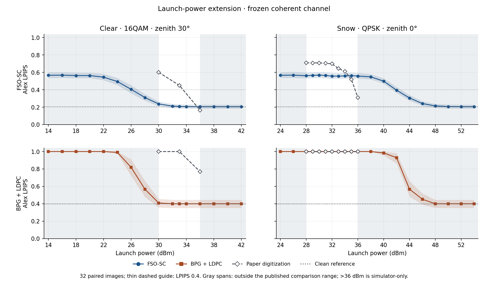

# 재현 결과: v27 및 v31–v35

[English version](LATEST_RESULTS.md) · [한국어 README](../README.ko.md) · [논문 그림별 결과](PAPER_FIGURES.ko.md) · [논문 표 비교](PAPER_TABLES.ko.md) · [재실행에 필요한 파일](REPLAY.ko.md) · [이전 독립 평가 결과(200장)](RESULTS.md)

**경향을 확인한 부분 재현이다.** 시뮬레이터의 송신 광전력 범위를 넓히면 FSO-SC의 복원 품질은 점진적으로 회복되는 반면, BPG+LDPC는 더 급격하게 회복된다. 다만 이 전환은 논문과 같은 전력에서 일어나지 않는다. 아래 실험은 독립적으로 학습한 가중치와 대체 평가 영상으로 수행했다. 논문에 보고된 3 dB 이득, VPI 수신기, 정확한 수치 곡선, 10 Gbps 하드웨어 실험 결과를 재현했다고 주장하지 않는다.

| 실험 | 범위 | 공개 결과 |
| --- | --- | --- |
| v27 | 고정된 v25 Stage 2 가중치와 영상 200장 사용. 서로 다른 채널 조건 × 전송 방식 조합 732개 및 무채널 영상 평가 400건 | [Fig. 4–8 결과](PAPER_FIGURES.ko.md) · [집계 734행](../results/paper_sweep_v27_aggregate.json) |
| v31 | v27의 영상 중 32장을 사용해 전력 범위 확장. 36개 조건 × 2개 전송 방식 | [집계](../results/power_extension_v31_aggregate.json) · [전력별 그래프](../results/figures/v31_power_response.png) · [전송 지표](../results/figures/power_extension_transport.png) |
| v32 | 같은 영상 32장과 36개 조건에서 Stage 1과 Stage 2 비교 | [집계](../results/stage_effect_v32_aggregate.json) · [복원 품질](../results/figures/stage_effect_quality_v32.png) · [전송 지표](../results/figures/stage_effect_transport_v32.png) |
| v33 | 동일한 수신 관측값 192개로 기존 DSP와 참 복소 채널 이득을 사용하는 진단용 수신기 비교 | [집계](../results/receiver_transition_v33_aggregate.json) · [그래프](../results/figures/receiver_transition_v33.png) |
| v34 | 동일한 수신 관측값 192개로 16QAM 블록 단위 위상 추적 방식을 기존 DSP 및 이상적 참조 수신기와 비교 | [집계](../results/qam16_repair_v34_aggregate.json) · [그래프](../results/figures/qam16_repair_v34.png) |
| v35 | Fig. 8(b) 저전력 확장. 기존 영상 32장으로 전송 평가 768건과 무채널 평가 64건 | [집계](../results/fig8b_lowpower_v35_aggregate.json) · [CSV](../results/fig8b_low_power_points.csv) · [복원 품질](../results/figures/fig8b_low_power_quality.png) · [전송 지표](../results/figures/fig8b_low_power_transport.png) |

v31–v35는 동일한 영상 32장을 재사용했으므로 **새로운 독립 평가(holdout)가 아니다.** 이전 독립 평가는 모델과 평가 절차가 다르므로 아래 결과와 합쳐 해석하면 안 된다. 표시된 95% 신뢰구간은 각 점에서 영상 단위 부트스트랩으로 계산한 것이며, 논문에서 읽은 근삿값의 불확실성을 나타내지 않는다. 공개 JSON에는 집계 지표와 코드·가중치 해시가 포함되며, 영상 목록, 프레임별 원시 기록, 재실행용 입력은 들어 있지 않다.

## v27–v31: 송신 광전력에 따른 복원 품질

v27은 코히어런트 채널 확장 모델과 고정된 v25 체크포인트를 사용해 논문 Fig. 4–8의 시뮬레이션 조건을 평가했다. Fig. 5의 예시는 논문의 원본 영상이 아닌 대체 영상으로 만들었다. v31은 채널, 모델, 기존 BPG 비트열을 그대로 두고 평가 전력 범위만 넓혔다. 전력축 이동, 잡음 재조정, 곡선 평활화, 논문 수치 외삽은 하지 않았다.

| FSO-SC 평가 조건 | 송신 광전력 | 논문 LPIPS (근사) | v31 Alex LPIPS |
| --- | --- | ---: | ---: |
| 맑음, 16QAM, 천정각 30° (Fig. 4) | 30 → 33 → 36 dBm | 0.600 → 0.450 → 0.165 | 0.237 → 0.208 → 0.205 |
| 눈, QPSK, 천정각 0° (Fig. 7) | 28 → 36 dBm | 0.709 → 0.310 | 0.561 → 0.558 |

논문 값은 [Fig. 4와 Fig. 7](https://doi.org/10.1109/TCOMM.2025.3562356)의 벡터 그래프에서 점의 좌표를 읽은 근삿값이며, 저자의 원시 측정값이 아니다. 평가 영상과 LPIPS 백본이 동일한지는 확인할 수 없다.

맑음 조건에서 논문 범위의 높은 전력 구간은 이미 무채널 기준값(0.205)에 가깝다. 그 범위보다 낮은 24–30 dBm에서는 v31의 맑음·16QAM LPIPS가 0.494에서 0.237로 개선된다. 눈·QPSK 조건은 논문 범위 밖인 40–48 dBm에서 0.499에서 0.214로 개선된다. 이 범위는 시뮬레이터 진단용이며 실제 장비의 권장 전력이 아니다. 맑음과 눈 조건의 전환 구간은 논문 대비 서로 반대 방향으로 어긋나 있으므로, 두 곡선에 동일한 전력축 이동을 적용해 맞출 수 없다.

BPG+LDPC 비교에서 맞춘 것은 평균 **원천 비트율**이다. FEC와 패딩을 포함한 실제 채널 사용 횟수는 동일하지 않다. 비교에 사용한 BPG+LDPC의 복원 품질이 급격히 개선되는 구간에서 복호 실패도 크게 줄었다. 그래프의 LPIPS 값 1은 복호 실패 표시이며, 실패 시 표시한 회색 대체 영상의 실제 LPIPS는 별도로 기록했다.

## v32: Stage 2는 오류가 있을 때 더 강건하지만 무채널에서는 불리

영상–채널 조건 조합 1,152개에 대해 채널 난수와 링크 기하 조건을 동일하게 맞췄다. 각 체크포인트가 자체 인코딩한 페이로드를 보내므로 수신 파형까지 같은 비교는 아니다. 무채널 Alex LPIPS는 Stage 1 **0.186**, Stage 2 **0.205**였다. Stage 1에서 Stage 2로 바꿨을 때 맑음 26 dBm에서는 평균 LPIPS가 **0.627에서 0.405로**, 눈 42 dBm에서는 토큰 오류율이 비슷한 상태(67.4%와 67.1%)에서 **0.646에서 0.395로** 개선됐다. 눈 42 dBm은 시뮬레이터 진단 전용 조건이다.

각 체크포인트의 무채널 LPIPS를 뺀 뒤 채널로 인한 품질 저하도 비교했다. 이 결과는 두 체크포인트의 강건성이 다르다는 근거가 되지만, 잡음 학습 자체의 인과 효과를 추가 학습 스텝이나 체크포인트의 다른 변화와 분리하지는 못한다.

## v33–v34: 수신기 진단과 선택적 개선

v33은 같은 수신 관측값을 기존 수신기와 참 복소 채널 이득으로 나누는 이상적 참조 수신기(oracle)에 넣었다. 맑음 26 dBm에서는 이상적 수신기를 썼을 때 BER이 **12.02%에서 6.76%로**, Alex LPIPS가 **0.405에서 0.378로** 낮아졌다. 눈 42 dBm에서 기존 수신기와 이상적 수신기의 BER은 각각 **8.271%와 8.265%**, LPIPS는 **0.395와 0.397**이었다. 눈 조건에서 전환이 나타나는 시험점들의 기존 QPSK 검출기는 모델링된 잡음과 페이딩을 전제로 한 조건부 QPSK BER 예측과 이미 가깝다. 따라서 **이 시뮬레이터에서는** 위상 추적 개선만으로 논문과의 차이가 해소될 가능성은 낮다.

v34는 초기 주파수 추정값, 수신 관측값, 채널, v25 가중치를 그대로 사용한다. 대신 여러 짧은 구간에서 각각 위상의 2π 불연속을 보정하는 방식에서, 16QAM 프레임 전체에 연속적인 위상 궤적 하나를 맞추는 방식으로 바꿨다. 24 dBm에서 BER은 **26.50%에서 10.68%로** (이상적 참조: 10.65%), Alex LPIPS는 **0.494에서 0.461로** 낮아졌다. 전환 구간인 24/26/28 dBm에서 평균 BER은 **7.69%p**(짝지은 비교의 95% 신뢰구간: 5.24–10.41%p), 평균 Alex LPIPS는 **0.0242**(0.0159–0.0344) 감소했다. 30/33/36 dBm에서 평균 LPIPS 변화는 **−0.00050**(95% 신뢰구간: −0.00126~+0.00029)이었다. 뚜렷한 성능 저하는 관찰되지 않았지만 두 방식의 성능이 동등하다는 뜻은 아니다.

v34는 별도의 수신기 개선안이다. **v27·v31 결과에 사용한 수신기가 아니며, 논문 재현 결과를 보정한 것도 아니다.** 평가하지 않은 링크 기하 조건에서는 검증되지 않았고, QPSK는 바꾸지 않았다. 이상적 참조 수신기는 진단용으로만 사용하며 실제 운용에는 쓸 수 없다.

## v35: Fig. 8(b) 저전력 확장

고정 v25 가중치, 원본 v27 BPG 비트열, 기존 v27 채널과 수신기를 사용했다. **선택적 개선안인 v34 수신기는 사용하지 않았다.** 기존 영상 32장에서 18–28 dBm을 2 dB 간격으로 평가해 단일 수신기 FSO-SC와 1/2/4수신기 MRC의 BPG+LDPC를 비교했다. 재학습, 파라미터 보정, 전력축 이동은 하지 않았다.

| 송신전력 | FSO-SC Alex LPIPS | 4수신기 BPG+LDPC Alex LPIPS | 짝지은 차이(4수신기 − FSO-SC)의 95% 신뢰구간 | BPG+LDPC 복호 실패(32장 중), 1/2/4수신기 |
| ---: | ---: | ---: | --- | ---: |
| 18 dBm | 0.5172 | 0.4001 | [−0.1700, −0.0659] | 31 / 19 / 0 |
| 20 dBm | 0.4362 | 0.4001 | [−0.0873, +0.0143] | 27 / 0 / 0 |
| 22 dBm | 0.3168 | 0.4001 | [+0.0451, +0.1214] | 10 / 0 / 0 |

관측 평균의 순위는 **20–22 dBm 사이**에서 바뀌었다. 논문 그래프에서 읽은 구간은 **약 30–31 dBm**이다. 두 구간 모두 실제 평가 지점 사이의 범위이며, 정확한 전환점을 추정한 값은 아니다. 20 dBm의 신뢰구간은 0을 포함하지만, 18 dBm과 22 dBm에서는 반대 순위가 확인됐다. 4수신기 BPG+LDPC는 모든 평가 전력에서 32장 모두 복호했고 무채널 LPIPS를 유지했다. 따라서 이 순위 교차는 복호 실패에 부여하는 표식에서 생기지 않았다. 양쪽에 공통인 28 dBm에서는 여전히 v35가 FSO-SC 우위, 논문 판독값이 4수신기 우위다. **정성적인 순위 변화**를 재현한 것이지 같은 전력에서 일치한 것은 아니다. 기존 v27의 200장 결과는 별도로 유지했다.

**집계 오류 수정:** 초기 v35 요약에서 1수신기만 복호에 실패한 장수를 반대 방향 항목에도 복사했다. 원래의 이미지별 기록을 다시 세면 **4수신기만 실패한 장수는 전력별로 모두 0장**이다. 공개 집계와 재실행 노트북의 집계 코드를 바로잡았다. LPIPS, BER, 수신기별 실패 건수, 짝지은 신뢰구간에는 변화가 없으며 실험도 다시 실행하지 않았다.
