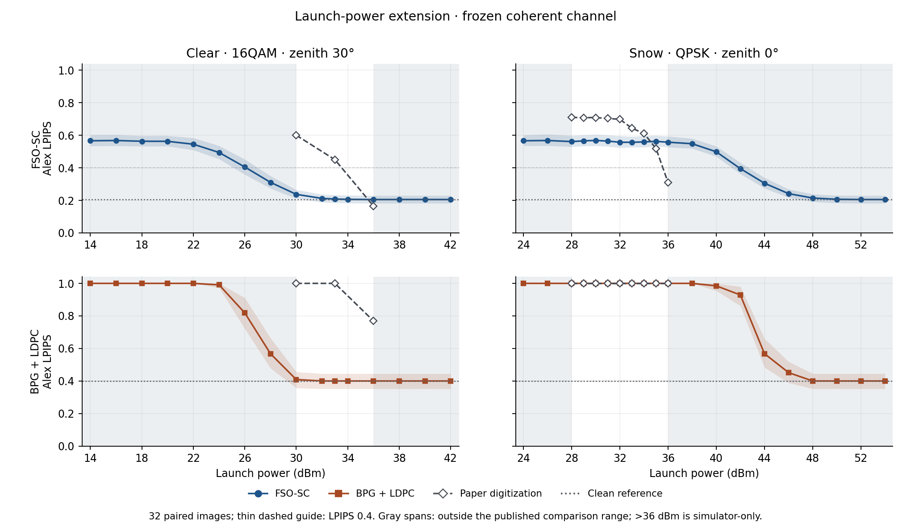

# Reproduction results: v27 and v31–v34

[English README](../README.md) · [한국어 README](../README.ko.md) · [Replay inputs](REPLAY.md) · [Earlier 200-image holdout](RESULTS.md)

**Qualitative, partial reproduction.** The wider sweeps show gradual FSO-SC recovery and a sharper BPG+LDPC transition in this simulator. They do not locate the transition at the paper's launch powers. The experiments below use independent weights and substitute evaluation imagery. None claims the authors' 3 dB gain, VPI receiver, exact numerical curves, or 10 Gbps hardware results.

| Run | Scope | Public evidence |
| --- | --- | --- |
| v27 | Frozen v25 Stage 2 on 200 images; 732 distinct channel-condition × method cases, plus 400 no-channel image evaluations | [734 aggregate rows](../results/paper_sweep_v27_aggregate.json) |
| v31 | Power extension on a 32-image subset of v27; 36 conditions × two methods | [Aggregate](../results/power_extension_v31_aggregate.json) · [Power curves](../results/figures/v31_power_response.png) · [Transport metrics](../results/figures/power_extension_transport.png) |
| v32 | Stage 1 vs. Stage 2 on the same 32 images and 36 conditions | [Aggregate](../results/stage_effect_v32_aggregate.json) · [Quality](../results/figures/stage_effect_quality_v32.png) · [Transport](../results/figures/stage_effect_transport_v32.png) |
| v33 | Existing DSP vs. true-complex-gain diagnostic on 192 shared observations | [Aggregate](../results/receiver_transition_v33_aggregate.json) · [Plot](../results/figures/receiver_transition_v33.png) |
| v34 | Optional 16QAM block phase tracking vs. existing DSP and oracle on 192 shared observations | [Aggregate](../results/qam16_repair_v34_aggregate.json) · [Plot](../results/figures/qam16_repair_v34.png) |

The v31–v34 runs reuse the same 32 images; they are **not new holdout experiments**. The earlier holdout used a different model and protocol and should not be pooled with these results. Where provided, confidence intervals are pointwise image-bootstrap 95% intervals, not uncertainty on the paper markers. The exported JSON contains aggregate metrics and code/weights digests, not image lists, raw frame records, or replay inputs.

## v27–v31: power response

v27 evaluates the published sample grids for the software simulations in Figs. 4–8, using the coherent channel extension and a fixed v25 checkpoint. Fig. 5 examples are generated from our images, not the paper's images. v31 keeps the channel, model, and existing BPG bitstreams fixed while extending the tested power range. No power offsets, noise retuning, smoothing, or extrapolated paper points are used.

| FSO-SC setting | Launch power | Paper LPIPS, approximate | v31 Alex LPIPS |
| --- | --- | ---: | ---: |
| Clear 16QAM, zenith 30°, Fig. 4 | 30 → 33 → 36 dBm | 0.600 → 0.450 → 0.165 | 0.237 → 0.208 → 0.205 |
| Snow QPSK, zenith 0°, Fig. 7 | 28 → 36 dBm | 0.709 → 0.310 | 0.561 → 0.558 |

The paper values were read from the vector markers in [Figs. 4 and 7](https://doi.org/10.1109/TCOMM.2025.3562356); they are not raw author measurements. We cannot verify the same evaluation images or LPIPS backbone.

Clear-air recovery is already close to the no-channel reference (0.205) at the high end of the published grid. Below that grid, v31 clear 16QAM improves from 0.494 to 0.237 at 24–30 dBm. Snow QPSK improves from 0.499 to 0.214 at 40–48 dBm, outside the published range; those powers are diagnostic simulator settings, not hardware recommendations. The opposite offsets in clear and snow rule out describing the two curves as aligned by a common power-axis shift.

The BPG+LDPC comparison uses the same mean **source** bitrate, not equal transmitted channel uses after FEC and padding. The tested baseline's faster change in decoded quality coincides with its sharp fall in decoding failures. Its LPIPS marker of 1 denotes a decoder failure; actual gray-fallback image LPIPS is stored separately.

## v32: Stage 2 recovers better under errors, not on a clean link

We matched channel randomness and geometry for 1,152 image-condition pairs. Each checkpoint still transmits its own encoded payload; this is not an identical received waveform comparison. No-channel Alex LPIPS was **0.186** for Stage 1 and **0.205** for Stage 2. At clear 26 dBm, mean LPIPS improved from **0.627 to 0.405**; at snow 42 dBm, from **0.646 to 0.395** at comparable token error rates (67.4% and 67.1%). Snow 42 dBm is a simulator-only diagnostic.

The report also subtracts each checkpoint's no-channel reference before comparing channel-induced degradation. This supports a robustness difference between the two checkpoints. It does not isolate the causal effect of noise training from additional updates or other changes in the checkpoint.

## v33–v34: receiver diagnosis and optional repair

v33 feeds the same observation to the existing receiver and to an oracle that divides by the true complex channel gain. At clear 26 dBm, the oracle lowers BER from **12.02% to 6.76%** and Alex LPIPS from **0.405 to 0.378**. In snow at 42 dBm, BER is **8.271% vs. 8.265%** and LPIPS is **0.395 vs. 0.397**. Across the tested snow transition points the current QPSK detector is already close to the conditional QPSK BER prediction under the modeled noise and fades. A better phase tracker alone is therefore unlikely to explain the snow discrepancy **in this simulator**.

v34 keeps the same coarse frequency estimate, observation, channel, and v25 weights, but fits one smooth phase trajectory over the 16QAM frame instead of unwrapping many local windows. At 24 dBm the BER drops from **26.50% to 10.68%** (oracle: 10.65%) and Alex LPIPS from **0.494 to 0.461**. Across the 24/26/28 dBm transition points, mean BER falls by **7.69 percentage points** (paired 95% CI: 5.24–10.41) and mean Alex LPIPS by **0.0242** (0.0159–0.0344). At 30/33/36 dBm the mean LPIPS change is **−0.00050** (95% CI: −0.00126 to +0.00029); no clear degradation was detected, but this is not an equivalence claim.

v34 is an engineering extension, **not the receiver used to report v27/v31, not a paper-reproduction correction**, and not validated on unseen geometries. It does not change QPSK. The oracle is a diagnostic reference and is not a deployable receiver.
