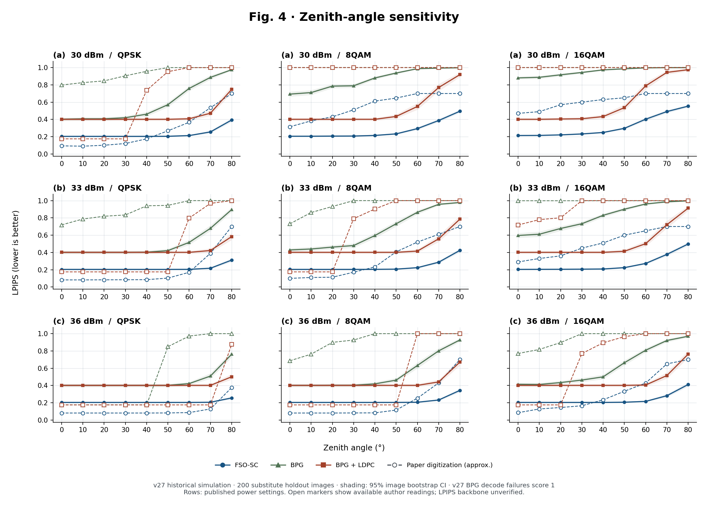
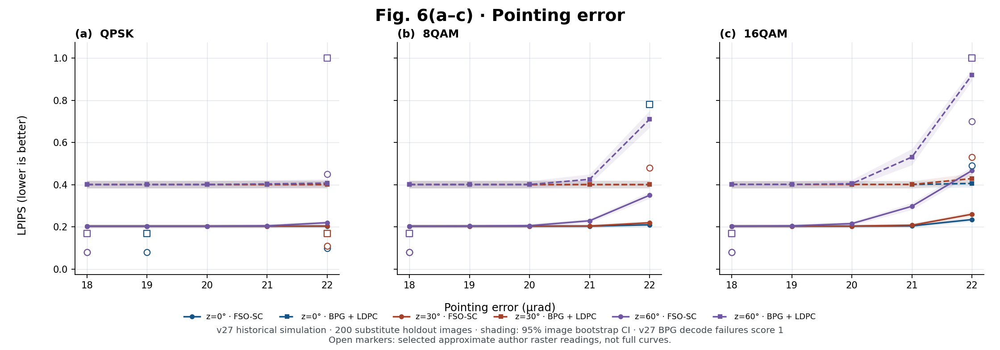
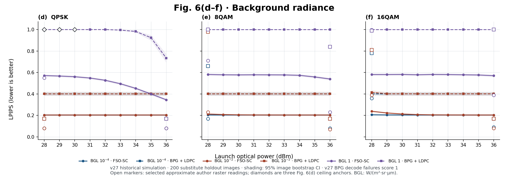
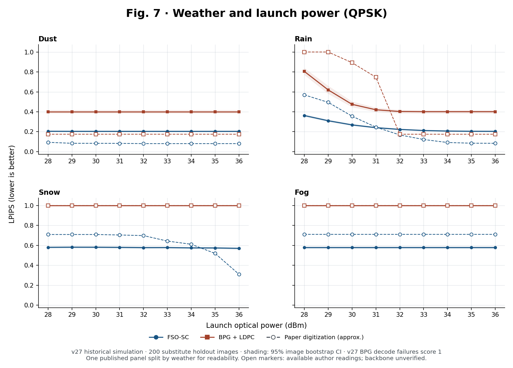
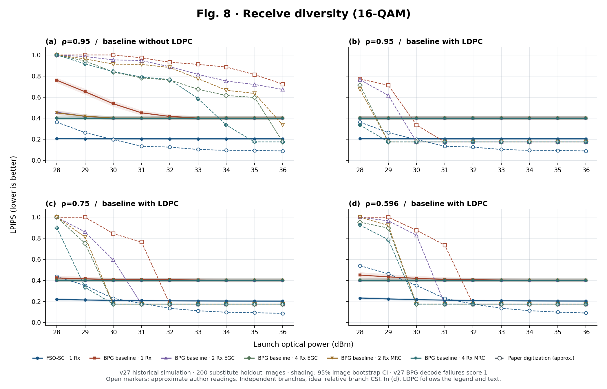

# 논문 그림별 재현 결과

[English version](PAPER_FIGURES.md) · [한국어 README](../README.ko.md) · [Table I–III 비교](PAPER_TABLES.ko.md) · [후속 진단 실험](LATEST_RESULTS.ko.md)

[Chen 외 (2025)](https://doi.org/10.1109/TCOMM.2025.3562356)의 그림 순서에 따라 결과를 정리했다. **v27에서는 Fig. 4·6·7·8에 제시된 소프트웨어 실험 조건을 모두 평가했다. 논문과 동일한 수치나 하드웨어 실험을 재현한 것은 아니다.** Fig. 5에는 대체 영상을 사용했다.

- **재현 조건:** v25 가중치와 v27 코히어런트 광링크 시뮬레이터를 사용했다. 링크 조건×전송 방식 732개와 무채널 기준 2개에서 각각 대체 영상 200장을 평가했다. 여러 그림에 나오는 같은 조건은 한 번만 실행했으며, 총 146,800회 평가했다.
- **논문과의 비교:** Fig. 4·7·8의 [벡터 마커 531점](../config/paper_gallery_reference.json)과 Fig. 6의 래스터 판독값 69점, 총 600점을 비교했다. 논문 그림에서 읽은 근삿값이며 저자의 원시 데이터가 아니다. 원래 축과 조건을 그대로 사용했고, 축 이동·평활화·논문 수치에 맞춘 피팅은 하지 않았다. 읽을 수 없는 점은 보간하지 않았다. 논문의 평가 영상과 LPIPS 백본은 확인되지 않았다.
- **평가 지표:** Alex LPIPS는 낮을수록 좋다. 논문의 표기 관례에 따라 그래프를 집계할 때 BPG 복호 실패는 1로 표시했다. 이 값은 실패 표식이지 실제 측정 LPIPS나 수학적 상한이 아니다. [재현값과 논문 판독값 CSV](../results/paper_gallery_points.csv)에서 비교 수치를, [v27 집계 JSON](../results/paper_sweep_v27_aggregate.json)에서 복호 실패 시 대체 영상의 LPIPS, BER, 실패율, 각 지점의 부트스트랩 신뢰구간을 확인할 수 있다.

**그래프 읽는 법:** 채운 마커는 v27 평균값, 주변 음영은 이미지 단위 부트스트랩 95% 신뢰구간이다. 빈 마커는 논문 그림에서 읽은 근삿값(`Paper digitization`)이다. Fig. 6에서는 재현 BPG+LDPC도 점선으로 표시하므로, 선 모양이 아닌 마커가 채워져 있는지로 구분한다. 영문 축의 `Launch optical power`는 송신 광전력, `Zenith angle`은 천정각, `Pointing error`는 지향 오차, `Background radiance`(BGL)는 배경광 복사휘도다.

## Fig. 4 — 천정각

송신 광전력 30·33·36 dBm에서 천정각을 0–80°까지 10° 간격으로 바꿨다. 지향 오차는 20 µrad로 고정하고, QPSK·8QAM·16QAM 각각에서 FSO-SC, 실제 BPG, 실제 BPG+LDPC를 평가했다(243점).

천정각이 커질수록 FSO-SC의 품질이 나빠지는 방향은 같았다. 30 dBm QPSK에서 천정각을 0°에서 80°로 바꾸면 LPIPS는 v27에서 **0.204 → 0.393**, 논문에서 **0.094 → 0.700**이었다. 16QAM·천정각 30°에서 30/33/36 dBm의 결과는 v27 **0.232/0.207/0.204**, 논문 **0.600/0.450/0.165**였다. 우리 모델은 논문에서 성능이 크게 개선되는 전력에 도달하기 전에 이미 무채널 기준에 가까웠다. [v31 전력 범위 확장](LATEST_RESULTS.ko.md#v27v31-power-response)은 시뮬레이터에서 성능이 크게 바뀌는 구간을 포함하지만, 논문에서 보고한 전력 이득을 검증한 것은 아니다.

## Fig. 5 — 복원 영상

v27에서 8QAM/16QAM × 33/36 dBm × FSO-SC/BPG+LDPC의 8가지 조건으로 예시를 생성했다. 천정각은 30°, 지향 오차는 20 µrad였으며, 모든 조건에 동일한 대체 영상과 확대 영역을 사용했다. 저자의 원본 영상은 확보하지 못했으므로 같은 장면의 픽셀을 비교한 것이 아니다. 아래 수치는 예시 한 장이 아닌 **전체 200장 평균**이다.

| 변조 방식·송신 광전력 | FSO-SC Alex LPIPS | BPG+LDPC Alex LPIPS | BPG+LDPC 복호 실패 |
| --- | ---: | ---: | ---: |
| 8QAM, 33 dBm | 0.2040 | 0.4012 | 0/200 |
| 8QAM, 36 dBm | 0.2038 | 0.4012 | 0/200 |
| 16QAM, 33 dBm | 0.2066 | 0.4012 | 0/200 |
| 16QAM, 36 dBm | 0.2038 | 0.4012 | 0/200 |

논문에서는 16QAM·33 dBm의 BPG+LDPC 예시를 복호하지 못했다. 우리 실험에서는 같은 링크 조건에서 대체 영상 200장을 모두 복호했다. 이는 Fig. 4에서 맑은 날의 품질 전환이 더 낮은 전력에서 나타난 것과 일관된 차이이며, 같은 장면에서 우수한 결과를 얻었다는 뜻은 아니다. 예시 영상 자체는 배포하지 않는다. [재실행에 필요한 비공개 입력](REPLAY.ko.md#replay-the-locked-v25-experiments)이 있으면 [v27 노트북](../notebooks/frozen/FSO_SC_paper_figures_full_v27.ipynb)으로 `plots/fig5_visual_examples.png`와 `paper_sweep_examples.zip`을 생성할 수 있다.

## Fig. 6 — 지향 오차와 배경광

**(a–c)**는 36 dBm에서 지향 오차 18–22 µrad와 천정각 0/30/60°를 조합해 QPSK·8QAM·16QAM을 평가했다(90점). **(d–f)**는 천정각 0°, 지향 오차 19 µrad에서 송신 광전력 28–36 dBm을 1 dB 간격으로 바꾸며 복사휘도 10⁻⁴, 10⁻², 1 W m⁻² sr⁻¹ µm⁻¹를 비교했다(162점). 논문의 3차원 그래프는 2차원 단면으로 나눠 표시했으며, 시뮬레이션 변수를 생략하지 않았다.

축을 보정해 얻은 [래스터 판독값 66점](../config/paper_gallery_fig6_raster_reference.json)과 [Fig. 6(d)에서 상한값 부근으로 읽힌 마커 3점](../config/paper_gallery_fig6d_anchors.json)을 비교했다. 논문의 곡선을 복원한 것이 아니라 판독한 점만 선 없이 표시했다. 그림을 읽는 데 따른 오차는 LPIPS 약 0.02이며, 통계적 신뢰구간은 아니다. 모델은 각 지향 오차 조건에서 각도 오프셋을 고정한다.

- **지향 오차:** (c)의 천정각 60°에서 지향 오차를 18 µrad에서 22 µrad로 늘리면 FSO-SC LPIPS는 **0.204 → 0.467**이었다(논문: 약 **0.08 → 0.70**). 악화되는 방향은 같지만 증가 폭은 더 작았다.
- **배경광:** 가장 밝은 배경광에서 QPSK 송신 광전력을 28 dBm에서 36 dBm으로 올리면 FSO-SC LPIPS는 **0.571 → 0.346**으로 개선됐다(논문: 약 **0.55 → 0.08**). 36 dBm에서 16QAM BPG+LDPC는 영상 **200/200장**의 복호에 실패했다. 반면 FSO-SC는 8QAM **0.539**, 16QAM **0.570**으로, 논문의 0.4 미만 결과는 재현하지 못했다.

## Fig. 7 — 기상

QPSK, 천정각 0°, 지향 오차 15 µrad에서 송신 광전력 9개(28–36 dBm)와 논문에 나온 기상 조건 4종(먼지·비·눈·안개)을 모두 평가했다. 논문은 한 패널에 표시했지만, 여기서는 읽기 쉽도록 기상별로 나눴다(72점).

v27의 먼지 조건은 이미 무채널 점수에 가까웠다. 비 조건에서 28–36 dBm의 LPIPS는 **0.363 → 0.204**로 개선됐다(논문: **0.570 → 0.084**). 눈·안개 조건에서는 논문 전력 범위 전체에서 BPG+LDPC가 영상 200장 모두의 복호에 실패했다. 눈 조건의 복호 실패는 논문과 일치하지만, 36 dBm의 FSO-SC LPIPS는 v27 **0.570**, 논문 약 **0.310**이었다. 눈 조건에서 품질이 크게 개선되는 구간은 논문의 전력 범위가 아니라, [v31 시뮬레이터 확장 실험](LATEST_RESULTS.ko.md#v27v31-power-response)의 더 높은 전력에서 나타났다.

## Fig. 8 — 수신 다이버시티

16QAM, 천정각 0°, 지향 오차 19 µrad, 송신 광전력 28–36 dBm에서 수신 분기 1/2/4개, 적용 가능한 결합 방식(MRC·EGC), Málaga 산란 비율 0.95/0.75/0.596을 비교했다. FSO-SC는 단일 수신기 기준이다. (a)는 FEC 없는 BPG, (b–d)는 BPG+LDPC와 비교했다(다른 그림과 중복되는 조건을 포함해 216점).

Fig. 8(d)의 캡션에는 **LDPC 미적용**, 범례와 본문에는 **LDPC 적용**으로 되어 있다. 재현에서는 범례와 본문을 따랐다. (b)의 28 dBm에서 논문 LPIPS는 수신기 1개의 약 **0.772**에서 수신기 4개(MRC)의 **0.335**로 낮아진다. v27에서는 두 조건 모두 BPG의 무채널 기준값 **0.401**에 이미 도달해 이 다이버시티 이득이 나타나지 않았다. 분기별 페이딩, 분기 간 상대 채널 정보, LDPC 구성은 독립적으로 구현했다.

## 모델 구조와 하드웨어 실험

| 논문 항목 | 재현 여부 |
| --- | --- |
| Fig. 1–3 — 링크·인코더·디코더 | 성능 그래프가 아닌 구조도다. [구현 가정](ASSUMPTIONS.md)에 코드에서 대응하는 부분과 독립적으로 결정한 부분을 정리했다. |
| Fig. 9 — 광학 실험 장치 | 논문의 별도 10 Gb/s PM-QPSK 실험 링크는 구성하지 않았다. [Table III](PAPER_TABLES.ko.md)는 해당 장치에 대응하는 링크 버짓을 독립 계산한 값이며, 하드웨어 측정값은 아니다. |
| Fig. 10 — 원천 비트율별 광전력 대비 LPIPS | 광학 장비 실험은 재현하지 않았다. 그림 축과 본문은 수신 광전력을 기준으로 한다(캡션에는 송신 전력으로 표기). Fig. 4–8의 송신 광전력과는 다르다. v27의 목표는 약 0.22 bpp 하나이며, 논문의 BPG 비트율 0.22/0.29/0.42/0.60 bpp 비교와는 다르다. |
| Fig. 11 — 광학 장비를 통한 복원 영상 | 실험 장비가 수집한 신호와 원본 영상이 없어 수신 광전력 −30.5 및 −34.1 dBm의 예시를 재현하지 않았다. Fig. 5의 대체 영상은 시뮬레이션 결과다. |
| Fig. 12 — 공간 정규화·잡음 학습의 효과 검증 | 하드웨어 비교는 재현하지 않았다. [v32](LATEST_RESULTS.ko.md#v32-stage-2-recovers-better-under-errors-not-on-a-clean-link)는 기존 Stage 1·2 체크포인트의 시뮬레이터 비교다. 공간 정규화를 제거하지 않았고, 체크포인트 간 다른 변화와 잡음 학습의 영향을 분리하지도 않았다. |

### Fig. 10 관련 원천 비트율 비교(무채널)

v28에서는 v27 평가에 사용한 영상 중 32장으로, 광학 채널과 FEC 없이 Fig. 10의 압축 부분만 따로 비교했다. BPG 4:2:0은 화질이 아닌 파일 크기를 기준으로 목표 비트율에 맞췄다. 논문의 높은 수신 광전력 조건과 마찬가지로 BPG 비트율을 높이면 화질 차이가 줄어들었다. 다만 수신 감도를 측정한 실험도, 같은 영상에서 논문의 비트율 절감 효과를 검증한 실험도 아니다.

| 방식 | 실제 평균 원천 비트율 (bpp) | Alex LPIPS |
| --- | ---: | ---: |
| FSO-SC | 0.21875 | 0.2052 |
| BPG | 0.21875 | 0.4004 |
| BPG | 0.29004 | 0.3409 |
| BPG | 0.42004 | 0.2629 |
| BPG | 0.59998 | 0.1855 |

출처: v28 `factor_diagnostic_summary.json`의 `source_quality.results`, SHA-256 `4904e93e35168f67ecaae2743321771a2ff05704c5e74eb361bfc4d325f352a8`.

## 비교 그래프 다시 그리기

Matplotlib을 설치한 뒤 저장소 최상위 폴더에서 `python tools/plot_paper_gallery.py`를 실행한다. 공개된 집계와 논문 판독값만 사용하므로, 그래프를 다시 그리는 데 학습·GPU·원본 PDF·체크포인트·Drive 파일이 필요하지 않다. 벡터 마커를 직접 읽으려면 대응하는 논문 PDF와 `pypdf`를 준비해 [판독 도구](../tools/digitize_paper_gallery.py)를 실행한다.
