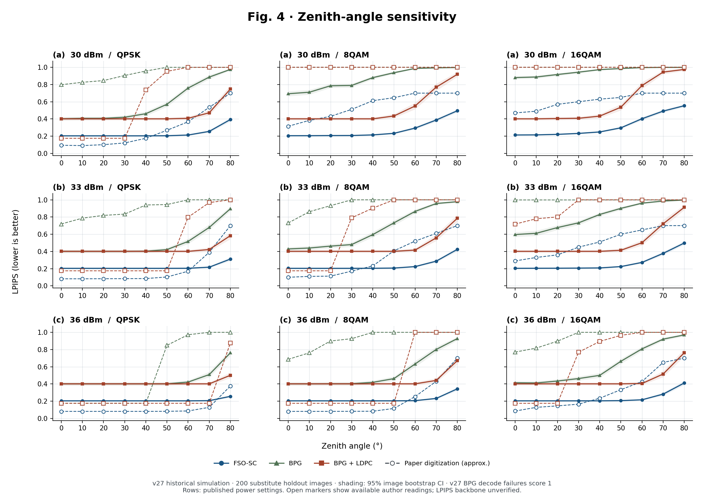
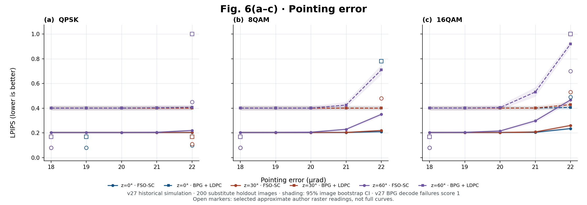
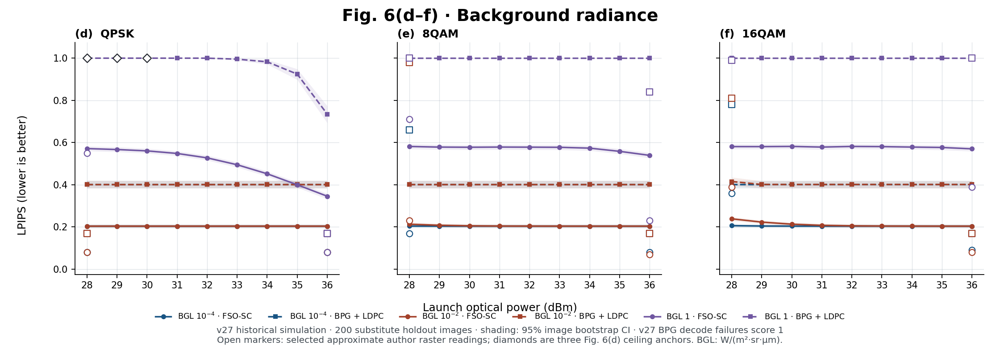
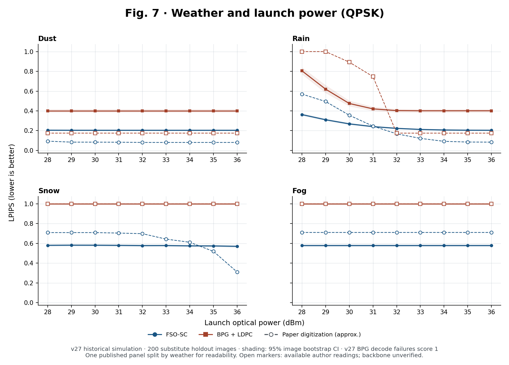
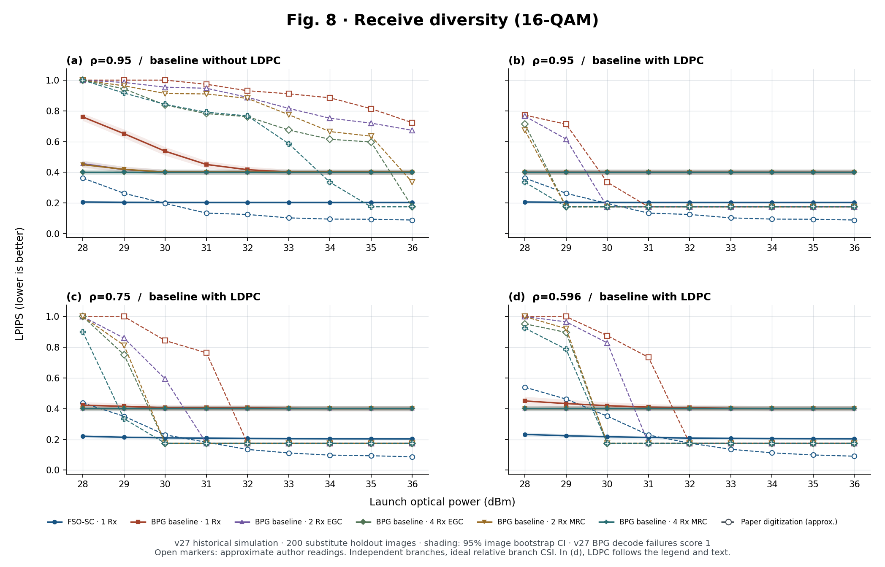

# Results by paper figure

[한국어](PAPER_FIGURES.ko.md) · [English README](../README.md) · [한국어 README](../README.ko.md) · [Tables I–III](PAPER_TABLES.md) · [Follow-up diagnostics](LATEST_RESULTS.md)

This gallery follows [Chen et al. (2025)](https://doi.org/10.1109/TCOMM.2025.3562356) figure by figure. **The v27 sweep covers the published software grids for Figs. 4, 6, 7, and 8. It does not reproduce the paper's numerical performance or hardware experiments.** Fig. 5 uses substitute scenes.

- **Reproduction:** v25 weights, v27 coherent software link, 200 substitute evaluation images per case, 732 unique link-condition × method cases, and two no-channel references. Cases reused across figures were evaluated once (146,800 image/method evaluations total).
- **Paper comparison:** The gallery compares 600 approximate paper readings: [531 vector markers](../config/paper_gallery_reference.json) in Figs. 4, 7, and 8, plus 69 raster readings in Fig. 6. These are not the authors' raw results. Comparisons retain the printed axes and conditions; no axis shift, smoothing, or fitting to the paper. Missing points are not interpolated. The paper's evaluation images and LPIPS backbone are not verified.
- **Metric:** The reproduction uses Alex LPIPS (lower is better) and follows the paper's convention of scoring failed BPG decodes as 1 in the plotted aggregate. This is a failure marker, not a measured LPIPS or a mathematical upper bound. See the [plotted values and matched paper readings (CSV)](../results/paper_gallery_points.csv) or the [v27 aggregate](../results/paper_sweep_v27_aggregate.json) for fallback LPIPS, BER, failure rates, and pointwise bootstrap intervals.

## Fig. 4 — Zenith angle

Three panels at 30, 33, and 36 dBm, with zenith angles 0–80° in 10° steps, pointing error 20 µrad, and QPSK/8QAM/16QAM. All three systems (FSO-SC, native BPG, native BPG+LDPC) are evaluated: 243 plotted points.

Both show FSO-SC degrading as zenith angle increases: at 30 dBm in QPSK from 0° to 80°, v27 goes from **0.204 to 0.393**, versus **0.094 to 0.700** in the paper. For 16QAM at 30° and 30/33/36 dBm, v27 is **0.232/0.207/0.204** versus **0.600/0.450/0.165**: our model is already close to its no-channel floor before the paper's transition. The [v31 extension](LATEST_RESULTS.md#v27v31-power-response) spans the transition in our simulator; it does not verify the reported power gain.

## Fig. 5 — Reconstructed images

v27 generated the eight example conditions using 8QAM/16QAM × 33/36 dBm × FSO-SC/BPG+LDPC, at 30° zenith and 20 µrad pointing. The same fixed substitute scene and crop were used across conditions. This is not a pixel comparison with the authors' unavailable sample. The table below gives means over **all 200 images**, not scores of a selected example.

| Modulation and power | FSO-SC Alex LPIPS | BPG+LDPC Alex LPIPS | BPG+LDPC decode failures |
| --- | ---: | ---: | ---: |
| 8QAM, 33 dBm | 0.2040 | 0.4012 | 0/200 |
| 8QAM, 36 dBm | 0.2038 | 0.4012 | 0/200 |
| 16QAM, 33 dBm | 0.2066 | 0.4012 | 0/200 |
| 16QAM, 36 dBm | 0.2038 | 0.4012 | 0/200 |

The paper's 16QAM BPG+LDPC example fails at 33 dBm. Our BPG+LDPC decoder succeeds on all 200 substitute images in that condition, consistent with the earlier clear-air transition in Fig. 4; this is a discrepancy, not a superior result on the same scene. Example scene pixels are not distributed here. With the [private replay inputs](REPLAY.md#replay-the-locked-v25-experiments), the [v27 notebook](../notebooks/frozen/FSO_SC_paper_figures_full_v27.ipynb) generates `plots/fig5_visual_examples.png` and `paper_sweep_examples.zip`.

## Fig. 6 — Pointing error and background light

**(a–c)**: pointing error 18–22 µrad × zenith angles 0/30/60° at 36 dBm, for QPSK, 8QAM, and 16QAM (90 points). **(d–f)**: 28–36 dBm in 1 dB steps × radiance 10⁻⁴, 10⁻², 1 W m⁻² sr⁻¹ µm⁻¹, at 0° zenith and 19 µrad pointing (162 points). The 3D plots are displayed as 2D slices; no simulated dimensions are omitted.

We compared [66 calibrated raster readings](../config/paper_gallery_fig6_raster_reference.json) and [three approximate Fig. 6(d) ceiling markers](../config/paper_gallery_fig6d_anchors.json). They are shown as unconnected points, not complete paper curves. Raster uncertainty is about 0.02 LPIPS from visual reading, not a statistical confidence interval. The model uses a fixed pointing offset at each sweep value.

- **Pointing:** In (c), increasing error from 18 to 22 µrad at 60° zenith raises FSO-SC LPIPS from **0.204 to 0.467**, versus approximately **0.08 to 0.70** in the paper. The direction matches, but the increase is smaller.
- **Background light:** At the brightest background, increasing QPSK power from 28 to 36 dBm improves FSO-SC from **0.571 to 0.346** (paper: approximately **0.55 to 0.08**). At 36 dBm the 16QAM BPG+LDPC baseline still fails on **200/200** images, but our FSO-SC scores of **0.539** (8QAM) and **0.570** (16QAM) do not reproduce the paper's below-0.4 result.

## Fig. 7 — Weather

QPSK at 0° zenith and 15 µrad pointing, nine power points (28–36 dBm), and all four weather conditions shown by the paper: dust, rain, snow, and fog. The paper uses one panel; the gallery separates the four weather conditions for readability (72 points).

In v27, dust is already close to the no-channel scores. Rain improves from **0.363 to 0.204** at 28–36 dBm (paper: **0.570 to 0.084**). In snow and fog, BPG+LDPC fails on all 200 images throughout the published grid. For snow, that failure result agrees with the paper, but FSO-SC is still at **0.570** at 36 dBm versus about **0.310** in the paper. The snow transition only appears at higher powers in the [v31 simulator extension](LATEST_RESULTS.md#v27v31-power-response), not at the published operating point.

## Fig. 8 — Receiver diversity

16QAM at 0° zenith, 19 µrad pointing, 28–36 dBm; 1/2/4 receiver branches, MRC and EGC where applicable, and Málaga scattering ratios 0.95/0.75/0.596. FSO-SC is a single-receiver reference. Panel (a) compares BPG without FEC, and (b–d) use BPG+LDPC (216 plotted points including reused cases).

The caption of Fig. 8(d) says **without LDPC**, while its plotted legend and the discussion indicate **with LDPC**. We follow the legend and discussion. At 28 dBm in (b), the paper shows LPIPS dropping from about **0.772** (1 Rx) to **0.335** (4 Rx, MRC). Both v27 cases are already at the BPG no-channel value **0.401**, so we do not recover that diversity gain. Branch fading, relative channel information, and the LDPC construction are independent simulator choices.

## Architecture and hardware

| Paper item | Status |
| --- | --- |
| Figs. 1–3 — Link, encoder, decoder | These are design diagrams, not performance graphs. The [implementation notes](ASSUMPTIONS.md) map the link and model to the code and list independent choices. |
| Fig. 9 — Optical bench | Not rebuilt: the paper uses a separate 10 Gb/s PM-QPSK experimental link. [Table III](PAPER_TABLES.md) is an independent calculation of its equivalent link budget, not a hardware measurement. |
| Fig. 10 — LPIPS vs. optical power at several source rates | Not reproduced on the optical bench. The plotted axis and body use received power (the caption says transmitted), not the launch-power axis of Figs. 4–8. v27 uses a single nominal 0.22 bpp target, not the paper's BPG sweep (0.22/0.29/0.42/0.60 bpp). |
| Fig. 11 — Optical-bench example reconstructions | Not reproduced at −30.5 and −34.1 dBm received power: no captured bench stream or original scene. Fig. 5 substitute examples are simulation only. |
| Fig. 12 — Spatial normalization / noise-training ablation | Not reproduced as a hardware ablation. [v32](LATEST_RESULTS.md#v32-stage-2-recovers-better-under-errors-not-on-a-clean-link) is a simulator comparison between existing Stage 1 and Stage 2 checkpoints; it neither removes spatial normalization nor isolates noise training from other checkpoint changes. |

### Fig. 10 source-rate check (no channel)

v28 isolates the compression part of Fig. 10 on 32 images reused from v27, without an optical channel or FEC. BPG 4:2:0 was rate-matched by file size, not by quality. Higher BPG rates close the quality gap, as the paper reports at high received power. This does not test received-power sensitivity or verify the paper's bitrate savings on the same images.

| Method | Actual mean source rate (bpp) | Alex LPIPS |
| --- | ---: | ---: |
| FSO-SC | 0.21875 | 0.2052 |
| BPG | 0.21875 | 0.4004 |
| BPG | 0.29004 | 0.3409 |
| BPG | 0.42004 | 0.2629 |
| BPG | 0.59998 | 0.1855 |

Source: v28 `factor_diagnostic_summary.json`, SHA-256 `4904e93e35168f67ecaae2743321771a2ff05704c5e74eb361bfc4d325f352a8`, `source_quality.results`.

## Regenerate the gallery

From the repository root, install Matplotlib and run `python tools/plot_paper_gallery.py`. The plots use only the released aggregates and paper reference points. No training, GPU, original PDF, model checkpoint, or Drive file is needed to redraw them. To independently extract the vector marker readings, use the [digitization helper](../tools/digitize_paper_gallery.py) with your own matching copy of the paper and `pypdf`.
